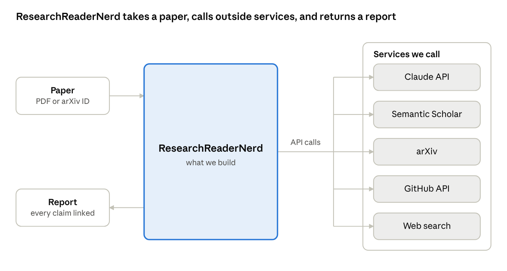
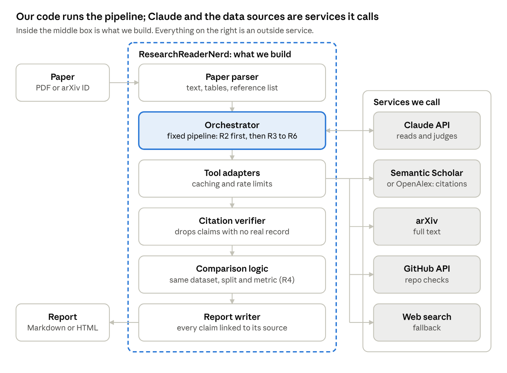

# ResearchReaderNerd: Requirements and Proposed Approach

Oct 8, 2026 · Ayush Iyer · [Live doc](https://claude.ai/code/artifact/f47cb012-c38b-4dd3-a5a1-3b0e2eee9dd1)

## Purpose

ResearchReaderNerd helps a reader understand a scientific paper and find ways to improve it. Given a paper (PDF or arXiv ID), it answers a fixed set of reader questions, and backs every claim about other work with a link that can be checked.

Recommendation in one line: use Claude as the reasoning engine, and give it tools that look up real papers, benchmarks and code. A plain prompt answers about half the questions; tools are what make the other half trustworthy.

## Requirements

The tool must answer six questions a reader asks about any paper. Two are fully answered by the paper's text. The other four need information from outside the paper.

| # | Reader question | Where the answer lives |
| --- | --- | --- |
| R1 | What are the assumptions of the model? | In the paper |
| R2 | What are the benchmarks used? | In the paper |
| R3 | Who else has experimented with those benchmarks? | Outside: other papers |
| R4 | Are the experimental results much better than the competition? | Both: this paper's numbers vs. others' reported numbers |
| R5 | Is there related work the article is missing (same benchmarks, similar assumptions, similar application)? | Outside: citation graph and literature search |
| R6 | Is the code available? | Both: the paper's link, plus whether the repo exists and is usable |

Non-functional requirements we suggest adding:

- Every claim about another paper carries a link (DOI, arXiv or Semantic Scholar).
- Every number taken from the paper cites its table or section.
- The output clearly separates what was found from what the model inferred.

## Why a plain LLM call is not enough

Pasting the paper into Claude with a good prompt handles R1, R2 and the in-paper half of R6 well. For R3 to R5 it fails in four ways:

1. **Knowledge cutoff.** The model does not know papers published after its training data. Those recent papers matter most for "who else" and "what is missing".
2. **Fabricated citations.** Asked for related work from memory, LLMs produce plausible titles, authors and scores that do not exist. In a literature check this is the worst error, because it looks right.
3. **No completeness.** "Who used benchmark X?" is a lookup in a citation database. Memory returns a sample, with no way to know what was left out.
4. **Numbers need sources.** Judging "much better than the competition" needs other papers' reported scores on the same dataset, split and metric. Those must be fetched and extracted, not recalled.

A cheap first test: run Claude with web search on a paper you know well. Where it invents papers or misses obvious ones, that is the gap this project closes.

## Proposed architecture

The product is the pipeline code, not Claude. Claude is one outside service we call, like Semantic Scholar or GitHub. Our code decides which steps run, in what order, and what gets into the report.

The detailed view below opens up the ResearchReaderNerd box into its parts.

Design choice: a fixed pipeline per question, not Claude planning its own tool calls. Claude is used only to read, extract and judge. A fixed pipeline is more predictable, easier to test and cheaper. Claude-driven planning can come later, for open-ended follow-up questions.

The citation verifier is the main thing that sets this apart from asking Claude directly: any paper Claude names that does not resolve to a real record is dropped or flagged.

## How each question is answered

Each question maps to one step and one main data source. Steps for R3 to R6 depend on the benchmark list from R2, so R2 runs first.

| # | Approach | Main data source |
| --- | --- | --- |
| R1 Assumptions | Claude reads the full text and lists explicit and implicit assumptions, each tied to a section or equation | Paper text |
| R2 Benchmarks | Claude extracts datasets, splits, metrics and the paper's own scores into a structured table | Paper text and tables |
| R3 Who else used them | Find each benchmark's source paper, then list papers that cite it and evaluate on it | Semantic Scholar or OpenAlex citation graph |
| R4 Better than competition? | Fetch the top R3 papers, extract their scores on the same dataset, split and metric, then compare like for like | arXiv full text plus Claude extraction |
| R5 Missing related work | Combine three searches: papers sharing benchmarks (R3), papers similar by embedding, and papers matching key assumptions. Remove anything the paper already cites | Semantic Scholar recommendations and search, paper's reference list |
| R6 Code available? | Find repo links in the paper, then check that the repo exists, its last commit, stars, license and whether it has a README with run instructions | Paper text, GitHub API |

Papers with Code used to be the obvious source for R3 and R4 leaderboards. It was shut down in 2025, so we should not depend on it (from memory; to confirm).

## Form factor

Recommendation: start as a Python CLI. It is the fastest to build, and the same core can later sit behind a web UI.

| Option | Effort | Strengths | Weaknesses |
| --- | --- | --- | --- |
| Prompt only (Claude app plus web search) | None | Free to try today; good for R1, R2 | Unreliable for R3 to R5; no structured output |
| Claude Code skill | Low | Reuses Claude Code's tools; easy to iterate | Tied to Claude Code; harder to share with non-developers |
| Python CLI (recommended) | Medium | Full control of tools and output; testable; produces a Markdown or HTML report | Needs an Anthropic API key and some setup |
| Web app | High | Easiest for others to use; can show a side-by-side reader | Hosting, auth and cost to manage; build after the CLI proves useful |

## Phased plan

Ship the in-paper questions first, then add one outside source at a time. Each phase is usable on its own.

1. **Phase 0: baseline.** Run the six questions as a prompt in Claude, with web search, on 3 papers you know well. Note where answers are wrong or invented. This becomes the test set.
2. **Phase 1: in-paper MVP (R1, R2, R6 link).** CLI takes a PDF or arXiv ID, extracts text, and asks Claude for structured output. Writes a Markdown report.
3. **Phase 2: citation graph (R3, R5).** Add Semantic Scholar tools: benchmark paper lookup, citing papers, recommendations. Filter out papers already cited.
4. **Phase 3: results comparison (R4).** Fetch the top competing papers, extract their scores, and build a like-for-like table with a link per row.
5. **Phase 4: code check (R6 full).** GitHub API check of repo existence, activity and license.
6. **Phase 5: polish.** Caching, an HTML report, then a web UI if others will use it.

## Risks and open questions

| Risk | Mitigation |
| --- | --- |
| Results are not comparable (different splits, metrics or compute) | Extract split and metric with every score; flag mismatches instead of comparing |
| Benchmarks without a citable source paper | Fall back to full-text search for the dataset name |
| Paywalled papers cannot be fetched | Use abstracts and metadata only, and mark them as such |
| API rate limits (Semantic Scholar) | Cache results and request a free API key |
| Cost per paper grows with many fetched competitors | Cap the number of competitors read in full, for example the top 10 |

Open questions:

- [ ] Which fields will this be used for first (ML, biology, physics)? This decides the data sources.
- [ ] Who uses it: only you, or a team or lab?
- [ ] Is an Anthropic API key available, and is there a monthly budget?
- [ ] Report format: Markdown, HTML, or both?
